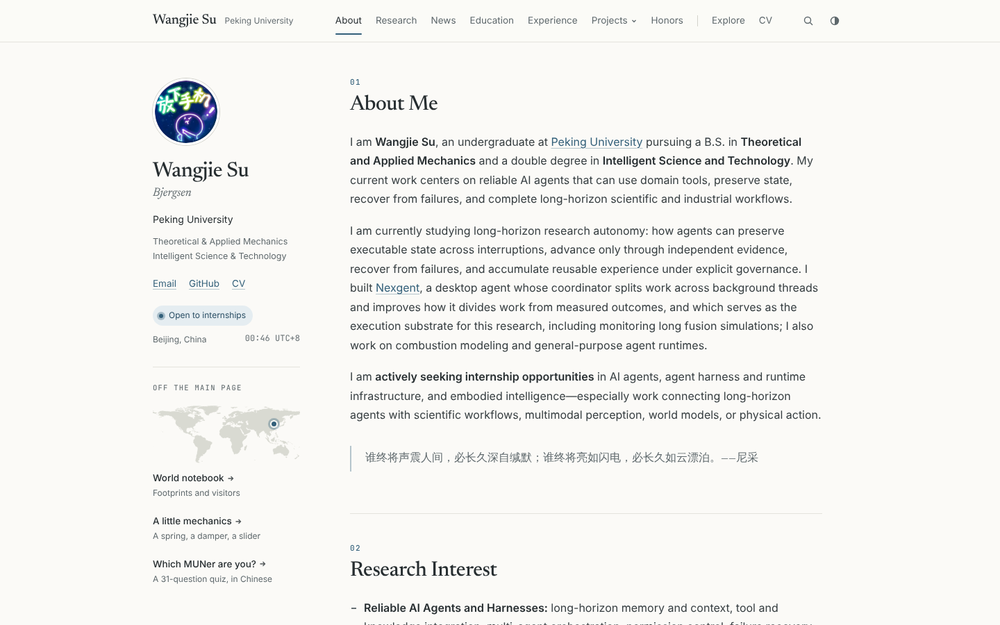

# Wangjie Su · Personal Homepage

Source of **<https://csxq0605.github.io>**, the personal homepage of Wangjie Su (Peking University: Theoretical & Applied Mechanics, Intelligent Science & Technology), built with Jekyll and served by GitHub Pages.



## 页面结构

| 页面 | 内容 |
|---|---|
| `/` 首页 | 左侧个人资料与小组件，右侧依次为 About Me、Research Interest、News、Education、Experience、Publications、Projects、Honors；底部是世界地图和鱼塘 |
| `/projects/<名称>/` | 每个项目的介绍与 README；首页点项目卡片时，以侧边面板打开同样的内容 |
| `/explore/` | 世界地图（足迹 / 访客）与阻尼振子小实验 |
| `/cv/` | 中英文简历 PDF |
| `/test/` | 模联人格测试 |

## 怎么改内容

大部分内容都在 `_data/` 的数据文件里，改完推送到 `main` 即可，GitHub Pages 会自动重新发布。

| 想改的 | 文件 |
|---|---|
| 简介、研究兴趣、新闻、荣誉 | `_pages/about.md` |
| 教育 | `_data/education.yml` |
| 经历（摘要始终显示，`details` 可折叠） | `_data/experience.yml` |
| 论文（只放已发表的学术论文；Cite 按钮自动生成 BibTeX） | `_data/publications.yml` |
| 项目卡片、顶部 Projects 菜单、搜索里的项目 | `_data/projects.yml` |
| 去过的地方（城市级） | `_data/explore.yml` 的 `travel:` |
| 侧栏小组件的开关与顺序、世界地图、鱼塘 | `_data/widgets.yml` |
| 简历 PDF | `assets/cv/` |
| 姓名、邮箱、GitHub、头像等 | `_config.yml` 的 `author:` |

## 自动更新

| 工作流 | 频率 | 作用 |
|---|---|---|
| Sync project READMEs | 每周一 | 把各项目仓库的 README 和图片复制进 `_projects/`、`assets/projects/` |
| GitHub activity widget | 每周一 | 更新侧栏的 GitHub 贡献热力图 `_data/github_activity.json` |
| Visitor atlas | 每天 | 访客地图数据；在 `_data/analytics.json` 填写 GoatCounter 站点前不做任何事，开启方法见 [`docs/visitor-statistics.md`](docs/visitor-statistics.md) |

都可以在 GitHub 的 **Actions** 页面手动运行。公开仓库连续 60 天没有提交时，GitHub 会暂停定时任务，需要到 Actions 页面重新启用。

## 本地预览

```bash
bundle install
bash run_server.sh          # http://127.0.0.1:4000，改动后自动刷新
```

`Gemfile.lock` 锁定的是较旧的 `github-pages` 依赖，需要 Ruby 2.7。

检查：

```bash
python3 -m unittest discover tests                  # 访客统计导出
python3 -m http.server 4100 --directory _site &     # 先 bundle exec jekyll build
node tests/verify_site.js http://127.0.0.1:4100     # 页面与交互（需要 playwright）
```

## 文档

- [`docs/homepage-design.md`](docs/homepage-design.md)：视觉与导航的设计说明
- [`docs/个人主页创意功能调研.md`](docs/个人主页创意功能调研.md)、[`docs/个人主页小组件调研.md`](docs/个人主页小组件调研.md)、[`docs/经历展示方式调研.md`](docs/经历展示方式调研.md)：调研报告
- [`docs/visitor-statistics.md`](docs/visitor-statistics.md)：开启访客统计

## 致谢与许可

- 最初基于 [AcadHomepage](https://github.com/RayeRen/acad-homepage.github.io)（Yi Ren，MIT 许可，见 [`LICENSE`](LICENSE)）。AcadHomepage 本身受 [minimal-mistakes](https://github.com/mmistakes/minimal-mistakes) 与 [academicpages](https://github.com/academicpages/academicpages.github.io)（均为 MIT）启发，并包含 Font Awesome（SIL OFL 1.1 / MIT）。
- 标题字体 [Newsreader](https://github.com/google/fonts/tree/main/ofl/newsreader)（SIL OFL 1.1，见 `assets/fonts/newsreader/OFL.txt`）。
- 世界地图源自 [world-atlas](https://github.com/topojson/world-atlas) / Natural Earth（公有领域）；国家中心坐标源自 [mledoze/countries](https://github.com/mledoze/countries)（ODbL）。
- 节气与农历节日日期由 [lunar-javascript](https://github.com/6tail/lunar-javascript)（MIT）离线生成，存于 `_data/calendar.json`。
